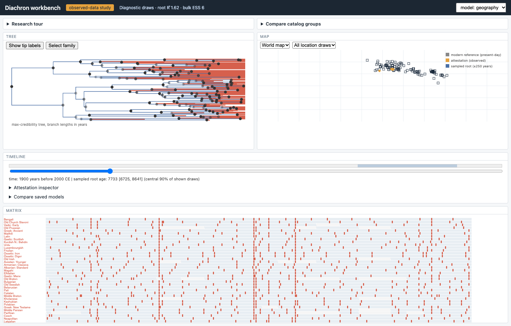

# Diachron

Diachron explores how language families diversify, share cognate classes and
change their geographic distributions. The inference engine combines a Rust
pruning likelihood with Python models for dated terminal tips, strict and
relaxed clocks, site-rate heterogeneity, and bounded contact. A TypeScript
workbench reads saved draws and connects the tree, map, timeline, lexical
matrix and attestation inspector.

A language family tree describes a hypothesis about linguistic descent.
Cognate classes have their own histories, and an inscription or reference
coordinate describes a locality at a particular evidentiary scale.

## Run the demo

Use CPython 3.12 to 3.14, Rustup, and Node 24 for the workbench.

```bash
make bootstrap
make build
make test
make demo
make verify EVIDENCE=runs/demo VERIFY_ARGS="--expected-commit $(git rev-parse HEAD)"
.venv/bin/diachron export-workbench --bundle dated=runs/demo/dated
cd ui
npm ci
npm run dev
```

The demo uses a labeled synthetic corpus. The verifier checks the saved tree
and model state against the stored score. Open the workbench URL printed by
Vite to inspect the same draws. Workbench interactions use the exported file.

## Observed inputs and results

The pinned Indo-European study has 152 eligible IE-CoR varieties and 170
meanings. The Austronesian study uses a 40-variety ABVD subset. A separate
EDH cohort contains 175 individually sourced Latin inscriptions. The
[acquisition and freeze guide](docs/OBSERVED_DATA.md) gives exact input
versions, licenses, filters and commands.

All 16 full-budget observed chains finished. Each model missed the frozen
convergence thresholds. [Observed inference](docs/results/full-inference.md)
links the raw checkpoints and replay commands. Nominal 90% root-age intervals
covered 144 of 200 true ages in the misspecification study and 177 of 200 in
the matched study. [Synthetic recovery](docs/results/recovery_200.md)
The eight predictive and 20 sensitivity fits finished and independently
replayed. All missed convergence. [Observed campaign](docs/results/observed-campaign.md)
The [build status](docs/BUILD_STATUS.md) tracks research and release gates.



## Source and research notes

- [Rust engine](rust/diachron-core/src) for transition matrices, pruning and the binary contact mixture.
- [Python package](python/diachron) for verified ingestion, inference, replay and experiments.
- [Workbench](ui/src) for visualization and source inspection.
- [Architecture](docs/ARCHITECTURE.md), [specification](docs/SPECIFICATION.md),
  [reproducibility](docs/REPRODUCIBILITY.md), and [diagrams](docs/diagrams).
- [Thesis chapters](docs/thesis) and [research notes](docs/notes).
  Run `make thesis` for assembled Markdown and standalone HTML.

The project source is [MIT licensed](LICENSE). Data sources carry their own
licenses. Lexical inputs and generated Arrow tables remain in local study
directories.
