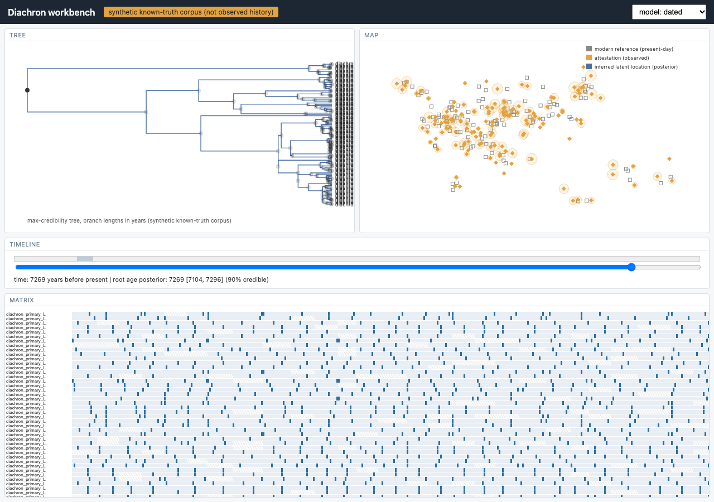

# Diachron

Diachron studies how language families diversify, borrow words, and shift their
geographic footprint, and it does so under uncertain evidence. It infers
posterior distributions over family trees, divergence times, borrowing, and
latent lineage locations from cognate data and dated attestations, and it keeps
the line between what was observed, what was inferred, and what is merely
illustrated visible at every step.

A language is not a population. A word lineage is not a language tree. Neither is
a genetic ancestry tree. Diachron keeps these apart in both the models and the
interface.

## What is here

- An original phylogenetic likelihood: continuous-time Markov cognate evolution,
  a Felsenstein pruning recursion with log-space scaling, and an ascertainment
  correction, implemented in Rust (`rust/diachron-core`) and validated against an
  independent brute-force enumerator.
- Original Metropolis-Hastings MCMC with branch-length, node-time, clock-rate,
  and topology moves, checkpointed for exact CPU resume.
- Clock and calibration models, a bounded borrowing/contact model, and
  region-based and spherical geographic transition models.
- A Python orchestration layer (`python/diachron`) for CLDF ingestion, dated
  attestations, inference, diagnostics, posterior predictive checks, sensitivity
  analysis, and a research CLI.
- A linked tree / globe / timeline / lexical-matrix workbench (`ui/`) that reads
  saved posterior artifacts and never triggers hidden inference.
- A thesis and a set of focused research notes under `docs/`.

## Quick start

```bash
# 1. Toolchain: Python 3.11+, Rust (stable), Node 18+.
make bootstrap        # create the venv and install Python tooling
make build            # compile the Rust core and install the extension
make test             # run the Rust and Python correctness suites
make demo             # run the bounded end-to-end demonstration
```

The demonstration ingests a small labeled-synthetic corpus, runs a short MCMC,
computes diagnostics, and writes posterior artifacts that the workbench can load.
It runs on a laptop in about eight seconds and needs no network access. Example
output from `make demo`:

```
[demo] dataset: 16 varieties, 80 concepts, 219 variable characters
[demo] 40 dated attestations; synthetic known-truth corpus
[demo] 4 chains done; acceptance rates [0.369, 0.387, 0.377, 0.396]
[demo] root age: true 6000, posterior mean 4950 +/- 987 years
[demo] split-Rhat 1.516, bulk-ESS 47
```

The short demo chains do not fully converge (split-Rhat above 1.01), and the demo
says so rather than presenting the draws as a settled posterior. The full
acceptance campaign uses much longer chains.

## The workbench

`diachron export-workbench` turns saved posterior bundles into a JSON the
TypeScript workbench reads; the workbench never runs inference. The four views
(tree, globe, timeline, lexical matrix) are linked by selection, and the map
keeps modern reference coordinates, dated attestations, and inferred latent
locations visually distinct.



## Status

This is an active build. `docs/BUILD_STATUS.md` tracks the acceptance gates and
what each one currently resolves to. Nothing here claims a recovered historical
map as proven: every historical statement is a posterior with stated uncertainty
and counterevidence, and the synthetic corpora used for known-truth tests are
always labeled synthetic.

## Layout

```
rust/diachron-core/   Rust likelihood, MCMC kernels, geographic models
python/diachron/      ingestion, models, inference, diagnostics, CLI
ui/                   TypeScript workbench (tree, globe, timeline, matrix)
data/                 dataset manifests and synthetic corpus generators
docs/                 specification, architecture, ADRs, thesis, notes, diagrams
tests/                Python correctness and integration tests
```

## Documentation

- `docs/SPECIFICATION.md` and `docs/ARCHITECTURE.md`: what it is and how it fits
  together.
- `docs/thesis/`: the study, chapter by chapter, with a claim-to-evidence ledger.
- `docs/notes/`: twelve focused research notes, including the negative results.
- `docs/adr/`: twelve architecture decision records.
- `docs/diagrams/`: twelve editable Mermaid diagrams with rendered SVGs, covering
  system context, the evidence lineage, the pruning messages, the proposal moves,
  the chain lifecycle, and more.
- `docs/EXPERIMENT_PLAN.md`, `docs/NUMERICAL_CONTRACTS.md`,
  `docs/REPRODUCIBILITY.md`, `docs/WALKTHROUGHS.md`, `docs/BIBLIOGRAPHY.md`,
  `docs/DATA_CARD.md`, and the live gate table in `docs/BUILD_STATUS.md`.

## What is established, and what is not

The mathematical results are checked: the pruning likelihood matches an
independent enumerator within 1e-9 over 1200 cases, the sampler reproduces exact
finite posteriors, the ascertainment correction matches its simulated selection,
and interrupted chains resume bit-for-bit. The historical results are posteriors
with stated uncertainty. A headline finding is that the inferred chronology is
identifiable only through calibration: the root-age estimate moves when
calibrations are removed or halved, and is stable to the tree-prior strength and
the ascertainment correction. Nothing here claims a recovered historical map as
proven.

## License

MIT. Dataset licenses are tracked separately per source; see
`docs/SPECIFICATION.md` and the data manifests. Restricted lexical records are
not redistributed.
