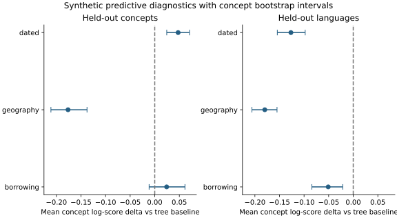

# Predictive diagnostics

Both held-out concept and held-out language experiments completed at
executable source `11fe5e485071f3984dec09090525354d89a0e4da`. Each model used
two chains with 600 warmup and 1800 sampling iterations. These experiments
use the synthetic primary corpus. Each character is scored by averaging
its likelihood over retained draws.

The held-out concept experiment scores 318 selected characters after
fitting on 1258 training characters. The dated model's mean concept score
difference relative to the tree baseline is +0.0475, with a 95% concept
bootstrap interval of [0.0244, 0.0707]. Geography is lower by 0.1763 and
the borrowing interval overlaps zero.

For held-out languages, the evaluation vocabulary is defined using the
training languages. It scores 1429 characters, using their held-out states
conditional on the training pattern. The tree baseline has higher scores
than all three alternatives in this diagnostic. The corresponding mean
concept differences are -0.1268 for the dated model, -0.1799 for geography
and -0.0509 for borrowing.

The changes in ranking across partitions limit interpretation. These are
short-chain diagnostics, and the bootstrap intervals describe variation
across concepts. They do not establish sampling convergence or account for
all dependence among meanings.

The [aggregate record](predictive-v2.json) and per-model score arrays share
the source identity. The [plotting script](../../scripts/plot_results.py)
reproduces both this figure and the recovery coverage figure.
